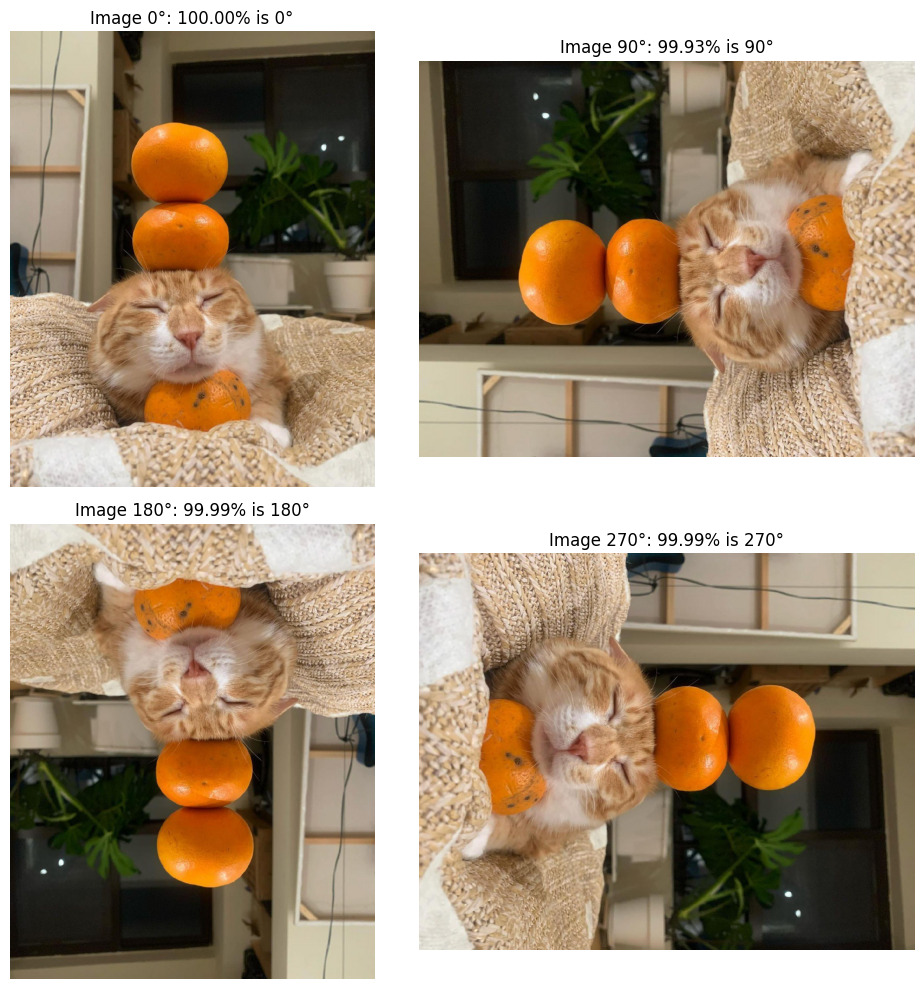

# THIS IS LEGACY PROJECT, SUPERSEDED BY https://github.com/zhemonJU/ixion 

##  Image Orientation Detection Using ResNet

Try it in Google Colab 

Or download the model from [GitHub Releases](https://github.com/zhemonJU/Deep-Learning-Kit/releases):

## Intro
this model is a fine-tuned variant of resnet152.

it's been converted to a classfication model with 4 classes. `0°, 90°, 180°, 270°`.

### Training Data
for fine-tunning this model, i used MS COCO (Microsoft Common Objects in Context) dataset.
`train2017` and `test2017` for training, and `val2017` for validation.

### Training Hardware
GPU: `NVIDIA GTX 1660 SUPER 6 GIB VRAM`

time per epoch: ~ 3h:45m

## Licence
same licence as resnet. `apache-2.0`
